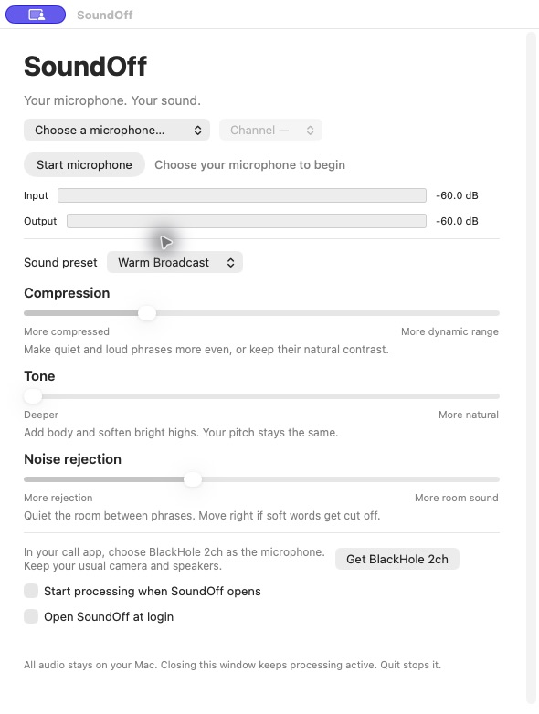

# SoundOff

A small, free microphone processor for macOS. Shape your voice with three plain-language controls, then use it in Google Meet, Zoom, Teams, QuickTime, or another app that accepts a microphone.



| Control | Left | Right |
| --- | --- | --- |
| Compression | More compressed: more even phrase levels | More dynamic range: more natural loud/quiet contrast |
| Tone | Deeper: fuller bass and softer highs | More natural: less tonal shaping |
| Noise rejection | Stronger gating between phrases | More room sound and quiet detail |

**Tone does not lower pitch.** Noise rejection is a soft gate/downward expander, not AI noise removal or speaker echo cancellation. Move it toward “More room sound” if it cuts off quiet speech.

Choose **Balanced**, **Natural**, or **Warm Broadcast**, then adjust to taste. Changes are saved automatically and take effect while the microphone is running. Warm Broadcast preserves the original app's warm, compressed voice preset.

## Requirements

- macOS 15 or later.
- A microphone or audio interface with an input channel.
- [BlackHole 2ch](https://existential.audio/blackhole/), installed separately from its official developer. Restart if its installer requests it.
- To build: Apple's Command Line Tools with Swift 6 or later (`xcode-select --install`). Full Xcode is not required.

SoundOff uses Apple's built-in Audio Units. There are no paid plug-ins, subscriptions, or trial timers. BlackHole is a separate project and is not bundled here.

## Build and use

```sh
git clone https://github.com/frankravizza/SoundOff.git
cd SoundOff
./test.sh
./build.sh
```

The app is created at `~/Library/Caches/SoundOffBuild/SoundOff.app`. Copy it to Applications, then open it.

1. Choose your physical microphone and, for a multichannel interface, its input channel.
2. Click **Start microphone** and allow macOS microphone access.
3. Choose a sound preset or adjust the three controls.
4. In your call or recording app, select **BlackHole 2ch** as the microphone. Keep your normal camera and speaker/headphone selections.
5. To start automatically, enable **Start processing when SoundOff opens** and **Open SoundOff at login**.

Closing the window leaves processing running. The microphone icon in the menu bar reopens it. **Stop microphone** or **Quit SoundOff** stops the sound sent to BlackHole.

Run only one processor into BlackHole at a time. Quit or stop any older microphone-processing app before starting SoundOff, or the signals can mix.

## Building for other Macs

```sh
ARCHS='arm64 x86_64' ./build.sh
```

This produces a universal Apple Silicon/Intel binary. A destination can also be passed:

```sh
./build.sh '/Applications/SoundOff.app'
```

Quit SoundOff before replacing its installed copy. Local builds are ad-hoc signed. This initial version is **not notarized for frictionless distribution**; a downloaded prebuilt copy may be blocked by macOS. Building locally is the supported path for now. Updates to an ad-hoc build may cause macOS to request microphone access again.

Maintainers can provide `CODESIGN_IDENTITY` to use their signing identity. Signing alone does not notarize a build.

## Privacy and routing

Processing runs locally. SoundOff does not record, upload, transcribe, or send telemetry. Only microphone access is requested; it does not capture other applications or the screen. The “Get BlackHole 2ch” button opens the developer's website in your browser.

The selected microphone and channel are remembered locally. SoundOff waits for that microphone to reconnect rather than substituting another input. It does not change the system's default speaker or microphone. BlackHole is the output for the processed voice; never select BlackHole as your system speaker.

## Audio design

The chain is: downward expander → bass EQ → voice compressor → high-band sibilance control → treble shelf → presence EQ → peak limiter → −1 dB output trim.

The macro controls vary related Audio Unit parameters together. The UI eases parameter changes without restarting the graph. A private Core Audio aggregate device synchronizes the microphone with BlackHole using drift compensation. The selected mono input is duplicated to left and right; only BlackHole's output channels receive the result.

Warm Broadcast uses +6 dB around 120 Hz, a −12 dB shelf at 1.2 kHz, a small 900 Hz presence lift, compression with a −30 dBFS threshold, and a gate/expander at −40 dBFS. Exact mappings are in [`VoiceSettings.swift`](Sources/VoiceSettings.swift).

The requested format is 48 kHz with a 128-frame I/O buffer. End-to-end delay also depends on the microphone, capture device, and conferencing app. Check speech and a visible clap when combining it with an HDMI camera.

## Tests and current limits

`./test.sh` uses synthetic signals and needs neither microphone permission nor BlackHole. It checks control endpoints, preservation of Warm Broadcast, saved settings, silence, stereo consistency, finite/unclipped output, gate attenuation, tone frequency response, compression behavior, and parameter changes while rendering.

The original processing route was used with a FIFINE USB microphone and BlackHole on an Apple Silicon Mac. This generalized version adds selectable devices; other interfaces, Intel hardware, sleep/reconnect behavior, and the login-service integration should be checked on target systems. The universal build compiles both architectures, but compilation is not a hardware test.

A gate cannot remove loud room noise during speech or cancel speaker playback. Use headphones or your call app's echo cancellation when needed. If your microphone clips before processing, reduce its hardware gain. SoundOff cannot repair clipped input.

## Development

- `Sources/App.swift`: native AppKit interface, permission flow, settings and login control.
- `Sources/VoiceSettings.swift`: presets, bounds and macro mappings.
- `Sources/AudioCore.swift`: device routing and Apple Audio Unit host.
- `Tests/AudioTests.swift`: deterministic audio and persistence checks.

The CI workflow builds both architectures and runs the audio tests on macOS. No recordings, personal device identifiers, or account preferences are included in the repository.

## License

SoundOff source code is available under the [MIT License](LICENSE). Apple's system frameworks and BlackHole retain their respective licenses. See [THIRD_PARTY_NOTICES.md](THIRD_PARTY_NOTICES.md).
